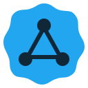

<div align="center">



# UserNet

**Защищённый доступ к сети — на телефоне и компьютере.**

[Скачать](https://www.userlay.com/usernet/) · [Сообщить об ошибке](https://github.com/localzet/UserNet/issues/new/choose) · [Правила безопасности](SECURITY.md)


</div>

## Приложение

UserNet — многоплатформенный VPN- и прокси-клиент на базе Mihomo. Он объединяет подписку Aura Network, выбор сервера и диагностику соединения; также можно добавлять совместимые профили других провайдеров.

### Платформы

Android, Windows, macOS и Linux. Актуальные файлы, системные требования и инструкции установки размещаются на [странице загрузки](https://www.userlay.com/usernet/).

### Возможности

- Добавление подписки по ссылке и управление аккаунтом Aura Network.
- Выбор профиля и прокси-сервера, проверка состояния и задержки.
- Mihomo как основное сетевое ядро; дополнительные способы доступа доступны в приложении, если поддерживаются сборкой и сетью.
- Обновления приложения с проверкой версии, размера и контрольной суммы пакета.
- Совместимые локальные профили Mihomo — отдельно от аккаунта Aura Network.

Некоторые функции зависят от ОС, сборки, настроек провайдера и доступности сети. UserNet не гарантирует обход любых блокировок или доступность сторонних сервисов.

## Установка

Скачивайте приложение только со [страницы UserNet](https://www.userlay.com/usernet/) или из [официальных релизов этого репозитория](https://github.com/localzet/UserNet/releases). Перед установкой сверяйте версию и контрольную сумму, если она опубликована. Не устанавливайте APK, EXE или пакеты из неизвестных источников.

## Сборка из исходников

Для воспроизводимой сборки используйте Flutter 3.47.6 (с входящим в него Dart), Go 1.27.1, Rust stable и инструменты целевой платформы. Для Android нужны Android SDK и NDK; для macOS — Xcode; Linux и Windows требуют системные пакеты и SDK соответствующей ОС.

```bash
git clone https://github.com/localzet/UserNet.git
cd UserNet
flutter pub get
dart setup.dart android   # или windows, macos, linux
```

Для локальной проверки:

```bash
flutter analyze --no-fatal-infos
flutter test
```

Перед отправкой изменений см. [CONTRIBUTING.md](CONTRIBUTING.md). Эти команды не заменяют тестирование сборки на целевой ОС и проверку реального сетевого сценария.

## Конфиденциальность и безопасность

Не публикуйте в Issues ссылки подписки, токены, IP-адреса узлов, платёжные данные, полные логи или резервные копии профилей. Сначала удалите из диагностических данных секреты и персональные сведения. Уязвимости сообщайте приватно по инструкции в [SECURITY.md](SECURITY.md), а не в публичном Issue.

## Участие в проекте

Баги и идеи отправляйте через [формы Issues](https://github.com/localzet/UserNet/issues/new/choose). Перед этим проверьте, нет ли похожей открытой заявки. Предложения кода оформляйте pull request в `main`; правила и проверки описаны в [CONTRIBUTING.md](CONTRIBUTING.md).

## Лицензия и авторство

Исходный код распространяется по GNU GPL v3.0; сторонние компоненты и медиа могут иметь дополнительные условия — см. `LICENSE` и уведомления рядом с соответствующими материалами. Экран «О программе» отдельно указывает автора UserNet и авторов исходного проекта.

