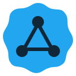

<div align="center">



# UserNet

**Private network access on your phone and computer.**

[Downloads](https://www.userlay.com/usernet/) · [Report a bug](https://github.com/localzet/UserNet/issues/new/choose) · [Security policy](SECURITY.md)


</div>

## The app

UserNet is a cross-platform VPN and proxy client built on Mihomo. It combines an Aura Network subscription, server selection and connection diagnostics. Compatible profiles from other providers can also be added separately.

### Platforms

Android, Windows, macOS and Linux. Current downloads, system requirements and installation instructions are listed on the [download page](https://www.userlay.com/usernet/).

### Features

- Add a subscription by link and manage an Aura Network account.
- Select a profile or proxy server and inspect connection state and latency.
- Mihomo as the primary network core; additional access methods depend on the build and network.
- App updates validate the version, artifact size and checksum.
- Compatible local Mihomo profiles remain separate from an Aura Network account.

Some features depend on the operating system, build, provider configuration and network availability. UserNet does not guarantee access through every type of filtering or availability of third-party services.

## Install

Download only from the [UserNet website](https://www.userlay.com/usernet/) or the [official releases for this repository](https://github.com/localzet/UserNet/releases). Verify the version and checksum when available. Do not install APK, EXE or packages from unknown sources.

## Build from source

For a reproducible build, use Flutter 3.47.6 (with its bundled Dart), Go 1.27.1, Rust stable and target-platform tools. Android needs the Android SDK and NDK; macOS needs Xcode; Linux and Windows need their platform SDKs and system packages.

```bash
git clone https://github.com/localzet/UserNet.git
cd UserNet
flutter pub get
dart setup.dart android   # or windows, macos, linux
```

Run local checks with:

```bash
flutter analyze --no-fatal-infos
flutter test
```

See [CONTRIBUTING.md](CONTRIBUTING.md) before submitting changes. These checks do not replace building on the target OS or validating a real network scenario.

## Privacy and security

Do not post subscription URLs, tokens, node IPs, payment details, full logs or profile backups in Issues. Remove secrets and personal data from diagnostics first. Report vulnerabilities privately using [SECURITY.md](SECURITY.md), not a public Issue.

## Contributing

Use the [Issue forms](https://github.com/localzet/UserNet/issues/new/choose) for bugs and ideas, after checking for duplicates. Send code changes as pull requests against `main`; see [CONTRIBUTING.md](CONTRIBUTING.md) for the workflow and checks.

## License and attribution

The source is distributed under GNU GPL v3.0. Third-party components and media may have additional terms; see `LICENSE` and the notices alongside those materials. The app's About screen distinguishes the UserNet fork author from authors of the upstream project.

